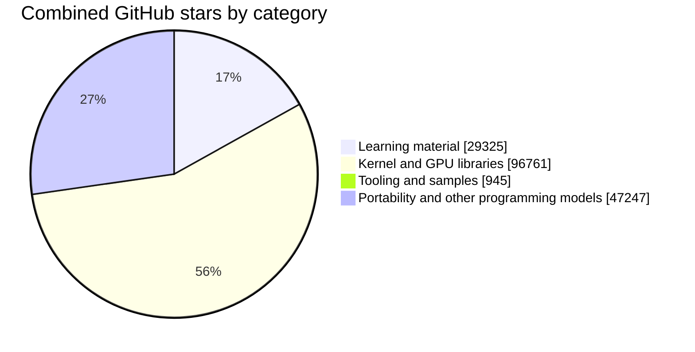

# Awesome Craft CUDA 

> A curated list of open-source CUDA learning material, kernel libraries, tooling and portability projects.

The NVIDIA CUDA Toolkit is proprietary. nvcc, CUDA-GDB, Nsight, cuBLAS, cuDNN and most official NVIDIA developer tools are distributed under NVIDIA's EULA, not an OSI licence. Open-source CUDA libraries often still need that toolkit to build or run. Portability projects are not automatically drop-in replacements for CUDA. This list repeats a drop-in claim only when the project's own documentation uses that wording, and then only with coverage caveats. SCALE by Spectral Compute is not listed as open source: its free licence is limited to non-commercial use.

## Contents

- [Dashboard](#dashboard)
- [Learning material](#learning-material)
- [Kernel and GPU libraries](#kernel-and-gpu-libraries)
- [Tooling and samples](#tooling-and-samples)
- [Portability and other programming models](#portability-and-other-programming-models)
- [Related lists](#related-lists)
- [Star history](#star-history)

## Dashboard

<table>
<tr>
<td align="center"><h2>24</h2>listed projects</td>
<td align="center"><h2>4</h2>categories</td>
<td align="center"><h2>174.3k</h2>combined GitHub stars</td>
<td align="center"><h2>26.7k</h2>combined forks</td>
<td align="center"><h2>18/24</h2>pushed in the last 30 days</td>
<td align="center"><h2>9</h2>languages</td>
</tr>
</table>

**FACT** (snapshot taken 2026-11-15, GitHub API): 24 listed projects, 24 of them on GitHub with public repository statistics. Official documentation and other non-GitHub entries are listed but have no stars, forks or push dates.

**ESTIMATE**: 174.3k combined GitHub stars and 26.7k combined forks, summed from those API counts on the snapshot date. Live star badges next to GitHub entries may differ.

### 🏆 Leaderboard

<table>
<tr><th>Rank</th><th>Project</th><th>Kind</th><th align="right">Stars</th><th></th></tr>
<tr><td align="center">🥇</td><td><b>FlashAttention</b></td><td>Attention kernels</td><td align="right">25.3k</td><td><code>████████████████████</code></td></tr>
<tr><td align="center">🥈</td><td><b>Triton</b></td><td>GPU kernel language</td><td align="right">20.6k</td><td><code>████████████████</code></td></tr>
<tr><td align="center">🥉</td><td><b>ZLUDA</b></td><td>CUDA on other GPUs</td><td align="right">15.2k</td><td><code>████████████</code></td></tr>
<tr><td align="center">4</td><td><b>Apache TVM</b></td><td>ML compiler</td><td align="right">13.9k</td><td><code>███████████</code></td></tr>
<tr><td align="center">5</td><td><b>GPU Puzzles</b></td><td>Tutorial</td><td align="right">12.6k</td><td><code>██████████</code></td></tr>
<tr><td align="center">6</td><td><b>CuPy</b></td><td>Python arrays</td><td align="right">12.4k</td><td><code>██████████</code></td></tr>
<tr><td align="center">7</td><td><b>Numba</b></td><td>Python JIT</td><td align="right">11.2k</td><td><code>█████████</code></td></tr>
<tr><td align="center">8</td><td><b>CUTLASS</b></td><td>GEMM templates</td><td align="right">10.7k</td><td><code>████████</code></td></tr>
<tr><td align="center">9</td><td><b>NVIDIA CUDA Samples</b></td><td>Official samples</td><td align="right">9.8k</td><td><code>████████</code></td></tr>
<tr><td align="center">10</td><td><b>GPU MODE lectures</b></td><td>Lectures</td><td align="right">7.0k</td><td><code>██████</code></td></tr>
</table>

### Stars by category

### Licences

    

"Custom" or "None" means GitHub could not match a standard SPDX licence, often because of extra terms or an undeclared licence. Read the project licence before you use it commercially.

## Learning material

- [GPU MODE lectures](https://github.com/gpu-mode/lectures) - Lecture notes and material from the GPU MODE community, covering CUDA kernel writing and related performance topics. 
- [GPU Puzzles](https://github.com/srush/GPU-Puzzles) - A puzzle-style tutorial that teaches GPU kernel ideas through small exercises. This is a teaching repository, not a production kernel library. 
- [NVIDIA CUDA Samples](https://github.com/NVIDIA/cuda-samples) - Official example programs that demonstrate CUDA Toolkit features. Building and running the samples generally requires a proprietary CUDA Toolkit install. 

## Kernel and GPU libraries

- [Apache TVM](https://github.com/apache/tvm) - A compiler stack for deploying machine-learning models and kernels onto a range of hardware backends, including GPUs. TVM is a compiler framework, not a CUDA source-level substitute. 
- [CCCL](https://github.com/NVIDIA/cccl) - NVIDIA CUDA C++ Core Libraries, unifying Thrust, CUB and libcu++. Component licences differ: Thrust and libcu++ use Apache-2.0 with listed exceptions, and CUB is BSD-3-Clause. Read the repository licence file for the component you use. 
- [CUDA Python](https://github.com/NVIDIA/cuda-python) - NVIDIA official Python bindings to the CUDA Toolkit. The bindings are open source; they still call into the proprietary CUDA Toolkit and driver. 
- [CuPy](https://github.com/cupy/cupy) - A NumPy and SciPy compatible array library that can use NVIDIA CUDA and, in supported builds, other GPU backends. This is a Python array layer, not a CUDA compiler. 
- [CUTLASS](https://github.com/NVIDIA/cutlass) - CUDA C++ template abstractions, and related Python DSLs, for high-performance GEMM and related linear algebra on NVIDIA GPUs. 
- [FlashAttention](https://github.com/Dao-AILab/flash-attention) - The official implementation of FlashAttention and FlashAttention-2. The README also describes ROCm backends; those backends are not implied to be complete substitutes for every CUDA build flag. 
- [HipKittens](https://github.com/HazyResearch/HipKittens) - The AMD and HIP counterpart to ThunderKittens, for writing similar tile-style kernels on AMD GPUs. This is not a drop-in compile of ThunderKittens CUDA sources. 
- [Kokkos](https://github.com/kokkos/kokkos) - A C++ performance-portability programming model with CUDA, HIP, SYCL and other backends. Code written in Kokkos is not automatically a drop-in of existing CUDA C++. 
- [NCCL](https://github.com/NVIDIA/nccl) - NVIDIA library for multi-GPU and multi-node collective communication. Most of the project is Apache-2.0, with some parts remaining under their original BSD licence. 
- [Numba](https://github.com/numba/numba) - A Python JIT compiler that includes a CUDA target for writing GPU kernels in Python. The CUDA target still depends on a CUDA toolchain when compiling for NVIDIA GPUs. 
- [rocBLAS](https://github.com/ROCm/rocBLAS) - AMD BLAS implementation for ROCm, often used when porting CUDA code that called cuBLAS. This is an AMD library, not a binary replacement for cuBLAS. 
- [ThunderKittens](https://github.com/HazyResearch/ThunderKittens) - A header-only CUDA framework of tile primitives for writing deep-learning kernels on NVIDIA GPUs. 
- [tiny-cuda-nn](https://github.com/NVlabs/tiny-cuda-nn) - A collection of fused CUDA kernels and bindings for small, fast neural networks. 

## Tooling and samples

- [nvbench](https://github.com/NVIDIA/nvbench) - NVIDIA C++ benchmark harness for CUDA kernels. Useful for measuring kernels you already build with the CUDA toolchain; it is not a substitute for Nsight Compute. 

## Portability and other programming models

- [AdaptiveCpp](https://github.com/AdaptiveCpp/AdaptiveCpp) - An open SYCL compiler stack, historically known as hipSYCL or Open SYCL, targeting multiple backends. Any CUDA-like compatibility layer should be treated as experimental unless the version you use documents otherwise. 
- [chipStar](https://github.com/CHIP-SPV/chipStar) - Compiles and runs HIP and CUDA applications on platforms that support SPIR-V, using OpenCL or Level Zero. The project documents unsupported or partial features; do not assume complete CUDA compatibility. 
- [HIP and HIPIFY](https://github.com/ROCm/HIPIFY) - AMD tools for translating CUDA to HIP so code can be retargeted to ROCm. AMD porting documentation describes a porting process with manual changes and testing, not a drop-in CUDA replacement. See also the HIP runtime repository. 
- [Intel llvm SYCL](https://github.com/intel/llvm) - Intel LLVM fork that implements SYCL and related oneAPI or DPC++ compilation. oneAPI as a product also includes proprietary or separately licensed components; this entry is the open compiler project. 
- [ROCm](https://github.com/ROCm/ROCm) - AMD open GPU software stack of compilers, runtimes and libraries with mixed licences. It is the usual home for HIP on AMD hardware, not a CUDA Toolkit substitute on NVIDIA hardware. 
- [Triton](https://github.com/triton-lang/triton) - A language and compiler for writing tiled GPU kernels at a higher level than raw CUDA C++. Triton is a different programming model, not a source-compatible replacement for nvcc. 
- [ZLUDA](https://github.com/vosen/ZLUDA) - A project whose README describes it as a drop-in replacement for running unmodified CUDA applications on non-NVIDIA GPUs. That wording is the project's claim; it is unofficial, architecture coverage is incomplete, and it is not a licence to the CUDA Toolkit. 

## Related lists

Other lists in the Awesome Craft series:

- [Awesome Craft](https://github.com/EdisonTKPcom/Awesome-Craft) - A curated list of open-source, self-hostable alternatives to popular SaaS tools.
- [Awesome Craft Agents](https://github.com/EdisonTKPcom/Awesome-Craft-Agents) - A curated list of open-source chat apps, coding agents, self-hosted agent bots, workflow automation and image-generation UIs.
- [Awesome Craft AI](https://github.com/EdisonTKPcom/Awesome-Craft-AI) - A curated list of open-source, self-hostable AI runtimes, servers, Hugging Face libraries and related infrastructure.
- [Awesome Craft BSC](https://github.com/EdisonTKPcom/Awesome-Craft-BSC) - A curated list of verified open-source clients, SDKs, dev tools and protocol code for BNB Smart Chain and opBNB.
- [Awesome Craft Creative](https://github.com/EdisonTKPcom/Awesome-Craft-Creative) - A curated list of open-source creative apps, including the storytold Craft App Suite and tools for photo, video, animation, 3D, audio and design.
- [Awesome Craft DeepSeek](https://github.com/EdisonTKPcom/Awesome-Craft-DeepSeek) - A curated list of official DeepSeek repositories and open-source harnesses, serving engines, eval tools and fine-tuning stacks that work with DeepSeek models.
- [Awesome Craft DevOps](https://github.com/EdisonTKPcom/Awesome-Craft-DevOps) - A curated list of open-source, self-hostable alternatives to popular DevOps and hosting SaaS tools.
- [Awesome Craft DNA](https://github.com/EdisonTKPcom/Awesome-Craft-DNA) - A curated list of open-source tools for DNA, genomics and synthetic biology.
- [Awesome Craft Ethereum](https://github.com/EdisonTKPcom/Awesome-Craft-Ethereum) - A curated list of verified open-source Ethereum clients, SDKs, dev frameworks, wallets and security tools.
- [Awesome Craft EV](https://github.com/EdisonTKPcom/Awesome-Craft-EV) - A curated list of open-source software and hardware for electric vehicles and charging.
- [Awesome Craft Hardware](https://github.com/EdisonTKPcom/Awesome-Craft-Hardware) - A curated list of open-source tools for PCB, FPGA, ASIC and chip design.
- [Awesome Craft Hyperliquid](https://github.com/EdisonTKPcom/Awesome-Craft-Hyperliquid) - A curated list of verified open-source SDKs, node tools, analytics and community libraries for the Hyperliquid ecosystem.
- [Awesome Craft Jarvis](https://github.com/EdisonTKPcom/Awesome-Craft-Jarvis) - A curated list of open-source tools to run a personal JARVIS-style AI assistant locally, including dashboards, agent runtimes, voice, MCP connections and memory.
- [Awesome Craft Malaysia](https://github.com/EdisonTKPcom/Awesome-Craft-Malaysia) - A curated list of open-source tools useful to Malaysian SMEs, with verified MyInvois support called out separately.
- [Awesome Craft Mars](https://github.com/EdisonTKPcom/Awesome-Craft-Mars) - A curated list of open-source tools and open data for Mars missions and settlement planning.
- [Awesome Craft Neuro](https://github.com/EdisonTKPcom/Awesome-Craft-Neuro) - A curated list of open-source tools for brain-computer interfaces, electrophysiology and neurotechnology.
- [Awesome Craft Robotics](https://github.com/EdisonTKPcom/Awesome-Craft-Robotics) - A curated list of open-source robotics software and hardware, including Microduck, Unitree SDKs, open humanoids, arms, simulation and middleware.
- [Awesome Craft SecondBrain](https://github.com/EdisonTKPcom/Awesome-Craft-SecondBrain) - A curated list of open-source tools for a personal second brain, including knowledge apps, LLM memory layers, RAG over notes, capture tools, MCP servers and knowledge graphs.
- [Awesome Craft Solana](https://github.com/EdisonTKPcom/Awesome-Craft-Solana) - A curated list of verified open-source Solana clients, SDKs, frameworks, explorers and program libraries.
- [Awesome Craft Space](https://github.com/EdisonTKPcom/Awesome-Craft-Space) - A curated list of open-source tools for spaceflight and rockets, covering orbit simulation, telemetry, launch data and more.
- [Awesome Craft Starlink](https://github.com/EdisonTKPcom/Awesome-Craft-Starlink) - A curated list of open-source tools for Starlink and other LEO satellite internet systems.
- [Awesome Craft Web3](https://github.com/EdisonTKPcom/Awesome-Craft-Web3) - A curated list of open-source DEX protocol code, self-custody software, indexers, frameworks and Blockchain infrastructure.

## Star history

## Contributing

Contributions welcome! Read the [contribution guidelines](contributing.md) first.

If this list is useful, give it a ⭐ so others can find it.

